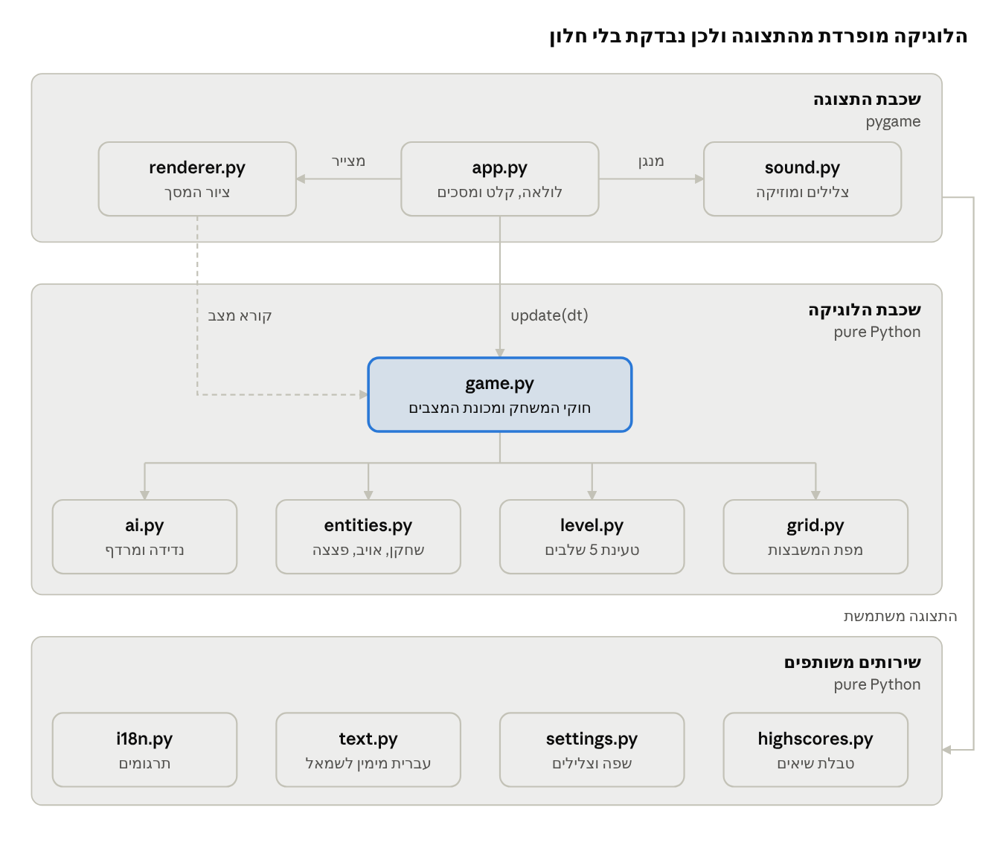

# Bomberman — Software Engineering Course Project

A complete Bomberman clone in Python + Pygame: 5 levels, two enemy types (one
uses BFS path-finding), power-ups, chain-reaction explosions, a level timer,
lives, pause, sound effects and music, English or Hebrew (right-to-left), and a
persistent high-score table. Sounds are synthesised in code and graphics are
drawn in code, so the game ships no media files.

## Documentation

| Document | Link |
|----------|------|
| Software Requirements Specification (Hebrew) | [docs/SRS.md](docs/SRS.md) · [live doc](https://claude.ai/artifact/YUsrtuZm8a6WFD5jfL7bHA) |
| Work plan & team roles (Hebrew) | [docs/WORK_PLAN.md](docs/WORK_PLAN.md) |
| Presentation, 13 slides (Hebrew) | [live deck](https://claude.ai/artifact/8EieE4a2x1gf9HTao65He2) |



## Install & run

**Windows, easiest:** double-click `PLAY_BOMBERMAN.bat`. It finds Python, installs pygame the first time, and starts the game.

Or from a terminal:

```bash
python -m pip install -r requirements.txt     # Python 3.10+
python main.py
```

## Controls

| Key | Action |
|-----|--------|
| Arrows / WASD | Move |
| Space | Drop bomb |
| P / Esc | Pause / resume |
| M | Sound on / off |
| Q (while paused) | Back to menu |
| Enter | Confirm |
| Left / Right (menu) | Change language or sound |

Language (English / עברית) and sound are chosen in the main menu and saved in
`settings.json`. Hebrew needs a system font with Hebrew letters (Arial, Segoe
UI or Tahoma on Windows, DejaVu Sans on Linux); without one the game stays in
English.

## Rules

* Destroy bricks with bombs. Some hide power-ups: **B** (+1 bomb), **F** (+1 range), **S** (speed).
* One brick hides the exit door. It opens (turns green) once every enemy is dead.
* Enemies, flames (including your own) and the timer running out each cost one life.
* Scoring: brick 10 · power-up 50 · balloon 100 · oneal 200 · level 500 + 5 per second left.

## Run the tests

```bash
python -m pip install pytest
python -m pytest -v
```

82 automated tests cover the game logic, sound synthesis, translations and
right-to-left text (~95% of the logic code). The logic
(`game.py`, `ai.py`, `level.py`, …) never imports pygame, which is why it can
be tested without opening a window.

## Project structure

```
main.py                 entry point
bomberman/
  config.py             every tunable constant (speeds, timers, scores)
  grid.py               Tile enum + Grid (the map)
  entities.py           Direction, Mover, Player, Enemy, Bomb, PowerUpType
  level.py              text level-file parser + validation
  ai.py                 enemy behaviour (wander, BFS chase)
  game.py               Game model + state machine (no pygame)
  highscores.py         JSON high-score table
  settings.py           language + sound settings (settings.json)
  i18n.py               all on-screen text in English and Hebrew
  text.py               right-to-left (bidi) reordering for Hebrew
  sound.py              sound effects + music synthesised in code, player
  renderer.py           all drawing (pygame primitives only), Hebrew font lookup
  app.py                window, main loop, input, menu, sound, screen switching
levels/level1..5.txt    the levels (editable by hand)
PLAY_BOMBERMAN.bat      one-click launcher for Windows
tools/generate_levels.py  regenerates the levels from fixed seeds
tests/                  pytest unit + integration tests
```

## Editing levels

Level files are text: `#` wall, `.` floor, `B` brick, `P` player start,
`E` balloon, `O` oneal, `X` brick hiding the exit, `1`/`2`/`3` bricks hiding
bomb/fire/speed power-ups. The border must be walls. Add `level6.txt` and the
game picks it up automatically.
