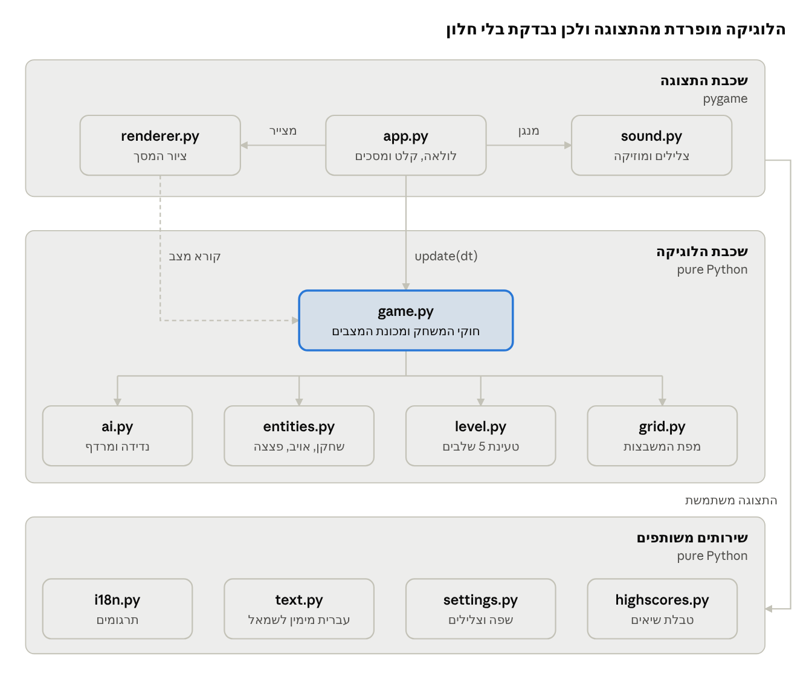
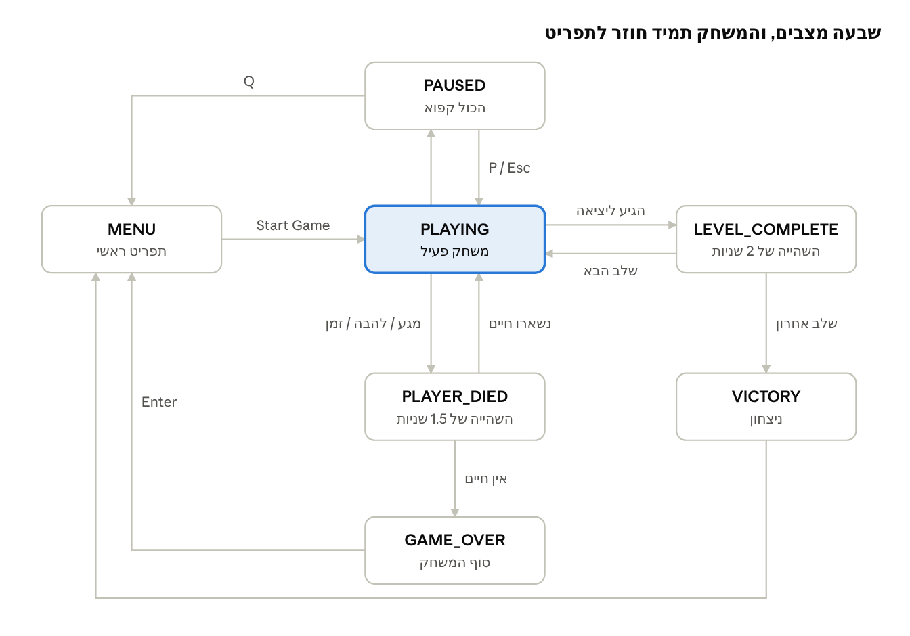

# Bomberman – מסמך אפיון דרישות (SRS)

> עותק Markdown של מסמך האפיון. הגרסה החיה והניתנת לעריכה: https://claude.ai/artifact/YUsrtuZm8a6WFD5jfL7bHA
> עודכן: 11 בנובמבר 2026 (גרסה 1.1: צלילים, עברית ו-5 שלבים)

## 1. מבוא

### 1.1 מטרת המסמך

המסמך מגדיר את הדרישות למשחק Bomberman, שפותח במסגרת פרויקט בקורס הנדסת תוכנה. הוא משמש בסיס משותף לצוות הפיתוח ולמרצה: מה המערכת עושה, איך היא בנויה, ואיך בודקים שהיא עומדת בדרישות. המבנה מבוסס על תקן IEEE 830 / ISO 29148.

### 1.2 היקף המוצר

Bomberman הוא משחק מבוך דו-ממדי לשחקן יחיד, שרץ על מחשב שולחני (Windows, macOS ו-Linux). השחקן מניח פצצות כדי לפוצץ לבנים ולחסל אויבים, אוסף שיפורים (power-ups) ומחפש את דלת היציאה. בגרסה 1.1 יש 5 שלבים, 2 סוגי אויבים, 3 סוגי שיפורים, צלילים ומוזיקת רקע, בחירה בין אנגלית לעברית, טבלת שיאים שנשמרת בין הפעלות, ו-84 בדיקות אוטומטיות.

מחוץ להיקף של גרסה 1.1: משחק רב-משתתפים ברשת, עורך שלבים גרפי, ושמירת מצב באמצע שלב.

### 1.3 הגדרות ומונחים

| מונח | הגדרה |
| --- | --- |
| משבצת (Tile) | יחידת המפה הבסיסית. המפה היא רשת של 15×13 משבצות בגודל 48 פיקסלים כל אחת |
| קיר (Wall) | משבצת שלא ניתן להרוס או לעבור דרכה |
| לבנה (Brick) | משבצת חוסמת שנהרסת בפיצוץ, ועשויה להסתיר שיפור או את היציאה |
| להבה (Flame) | משבצת בוערת שנוצרת בפיצוץ. היא קטלנית לשחקן ולאויבים למשך 0.5 שניות |
| טווח (Fire range) | מספר המשבצות שהלהבה מתפשטת לכל אחד מארבעת הכיוונים |
| תגובת שרשרת | פיצוץ שמגיע לפצצה אחרת ומפוצץ אותה מיד |
| שיפור (Power-up) | פריט שמשפר את השחקן: עוד פצצה (B), טווח (F) או מהירות (S) |
| BFS | חיפוש לרוחב: אלגוריתם שמוצא את המסלול הקצר ביותר ברשת. האויב O'Neal משתמש בו |
| FR / NFR | דרישה פונקציונלית / דרישה לא-פונקציונלית |
| UC / TC | מקרה שימוש (Use Case) / מקרה בדיקה (Test Case) |

## 2. תיאור כללי

### 2.1 חזון המוצר

משחק קלאסי שקל ללמוד תוך דקה ומספק כ-15 דקות משחק מלא. האתגר עולה משלב לשלב: יותר לבנים, יותר אויבים, ואויבים חכמים יותר שרודפים אחרי השחקן.

מבחינה הנדסית, העיקרון המרכזי הוא **הפרדה מלאה בין לוגיקה לתצוגה**. כל חוקי המשחק כתובים ב-Python נקי בלי Pygame, ולכן אפשר לבדוק אותם אוטומטית בלי לפתוח חלון.

### 2.2 משתמשים ובעלי עניין

| בעל עניין | תפקיד | מה חשוב לו |
| --- | --- | --- |
| שחקן | משחק ומתחרה על שיאים | שליטה מהירה וחלקה, חוקים ברורים, אתגר |
| מרצה / בודק | מעריך את הפרויקט | עקיבות מדרישה לקוד ולבדיקה, איכות תכנון |
| צוות הפיתוח | מפתח, בודק ומתחזק | קוד מודולרי, קבועים מרוכזים, בדיקות מהירות |
| מעצב שלבים | יוצר שלבים חדשים | פורמט קובץ פשוט שנבדק אוטומטית |

### 2.3 סביבת הפעלה

- Python 3.10 ומעלה, ו-Pygame 2.1 ומעלה
- חלון בגודל 720×680 פיקסלים, ב-60 פריימים לשנייה
- קלט ממקלדת בלבד. רמקולים לא חובה: בלי התקן שמע המשחק רץ בשקט. לתצוגה בעברית צריך גופן עם אותיות עבריות, כמו Arial שקיים בכל מחשב Windows

### 2.4 אילוצים

- שפת הפיתוח היא Python עם Pygame (דרישת הקורס)
- אין שימוש בקבצי תמונה או סאונד חיצוניים. הגרפיקה מצוירת בקוד והצלילים מסונתזים בקוד, כך שאין בעיית זכויות יוצרים ואין קבצים חסרים
- מספר השבועות לפיתוח מוגבל ללוח הזמנים של הסמסטר

### 2.5 הנחות ותלויות

- בצוות יש 4 סטודנטים, ולפרויקט מוקצבים 8 שבועות
- למשתמש יש אפשרות להתקין חבילות עם pip
- לתיקיית המשחק יש הרשאת כתיבה, כדי לשמור בה את טבלת השיאים

## 3. חוקי המשחק ומכניקות

כדי לעבור שלב צריך לחסל את כל האויבים, לחשוף את הדלת שמוסתרת מתחת לאחת הלבנים, ולהגיע אליה לפני שנגמר הזמן. כל הערכים בטבלאות שלמטה מוגדרים בקובץ אחד, `config.py`, ושינוי שלהם לא דורש נגיעה בלוגיקה.

### 3.1 תנועה

השחקן זז משבצת אחת בכל צעד, בקצב בסיסי של 5 משבצות לשנייה. על המסך התנועה מוצגת חלקה (אינטרפולציה). קירות, לבנים ופצצות חוסמים מעבר. שחקן שעומד על פצצה שהניח יכול לצאת ממנה, אבל לא לחזור אליה.

### 3.2 פצצות ופיצוצים

| פרמטר | ערך |
| --- | --- |
| זמן עד פיצוץ | 2.5 שניות |
| משך הלהבה | 0.5 שניות |
| פצצות בו-זמנית בהתחלה / מקסימום | 1 / 8 |
| טווח בהתחלה / מקסימום | 1 / 8 משבצות |

- הלהבה מתפשטת לארבעת הכיוונים עד גבול הטווח
- קיר עוצר את הלהבה. לבנה נהרסת ועוצרת אותה, כך שרק הלבנה הראשונה בשורה נהרסת
- להבה שמגיעה לפצצה אחרת מפוצצת אותה מיד (תגובת שרשרת)
- הלהבה קטלנית לשחקן עצמו ולכל אויב

### 3.3 אויבים

| אויב | מהירות (משבצות/שנייה) | ניקוד | התנהגות |
| --- | --- | --- | --- |
| Balloon (ורוד) | 2 | 100 | נודד: ממשיך ישר, ובסיכוי של 20% פונה בצומת |
| O'Neal (סגול) | 3 | 200 | נודד, וכשהשחקן במרחק של עד 6 משבצות הוא רודף אחריו במסלול הקצר ביותר (BFS) |

מגע בין אויב לשחקן (חפיפה של יותר מ-40% ממשבצת) הורג את השחקן.

### 3.4 שיפורים

| שיפור | סמל | אפקט |
| --- | --- | --- |
| Bomb Up | B | עוד פצצה אחת בו-זמנית (עד 8) |
| Fire Up | F | טווח פיצוץ גדול ב-1 (עד 8) |
| Speed Up | S | מהירות גדלה ב-1 משבצת לשנייה (עד 8) |

השיפורים מוסתרים מתחת ללבנים ונחשפים כשהלבנה נהרסת. שיפור שנאסף נשאר אצל השחקן גם אחרי שהוא מת.

### 3.5 חיים, זמן וניקוד

- לשחקן יש 3 חיים. כל מוות מוריד חיים אחדים ומתחיל את השלב מחדש. הניקוד נשמר
- לכל שלב יש 180 שניות. כשהזמן נגמר, השחקן מת
- הדלת נפתחת רק כשהיא חשופה וגם כל האויבים מתו

| אירוע | נקודות |
| --- | --- |
| הריסת לבנה | 10 |
| איסוף שיפור | 50 |
| חיסול Balloon | 100 |
| חיסול O'Neal | 200 |
| סיום שלב | 500, ועוד 5 על כל שנייה שנשארה |

### 3.6 השלבים

| שלב | צפיפות לבנים | Balloon | O'Neal | שיפורים מוסתרים |
| --- | --- | --- | --- | --- |
| 1 | 35% | 3 | 0 | B, F |
| 2 | 42% | 3 | 2 | B, F, S |
| 3 | 48% | 2 | 4 | B, F, S, F |
| 4 | 52% | 2 | 5 | B, S, F, S, F |
| 5 | 56% | 1 | 7 | B, S, F, S, F, S |

## 4. דרישות פונקציונליות

במערכת יש 17 דרישות פונקציונליות. 14 מהן בעדיפות Must, וכולן ממומשות בגרסה 1.1. הדרישות FR-16 (צלילים) ו-FR-17 (שפות) נוספו בגרסה זו, ומספר השלבים גדל מ-3 ל-5. העדיפויות נקבעו לפי שיטת MoSCoW. עמודת המודול מציינת באיזה קובץ ממומשת כל דרישה.

| מזהה | דרישה | עדיפות | מודול |
| --- | --- | --- | --- |
| FR-01 | המערכת תטען שלבים מקבצי טקסט ותאמת אותם: מפה מלבנית, גבול של קירות, נקודת התחלה אחת, יציאה אחת ולפחות אויב אחד. קובץ שגוי יידחה עם הודעת שגיאה מפורטת. המשחק כולל 5 שלבים | Must | level.py |
| FR-02 | המפה תהיה רשת של משבצות מסוג ריק, קיר או לבנה. השטח שמחוץ למפה מתנהג כקיר | Must | grid.py |
| FR-03 | השחקן יזוז בארבעה כיוונים, משבצת אחת בכל צעד, במהירות שלו. קירות, לבנים ופצצות יחסמו אותו | Must | game.py, entities.py |
| FR-04 | השחקן יניח פצצה במשבצת שלו, עד המכסה שלו של פצצות פעילות, ולא יותר מפצצה אחת במשבצת | Must | game.py |
| FR-05 | פצצה תתפוצץ אחרי 2.5 שניות. הלהבה תתפשט עד גבול הטווח, תיעצר בקיר ותהרוס רק את הלבנה הראשונה בכל כיוון | Must | game.py |
| FR-06 | להבה שפוגעת בפצצה אחרת תפוצץ אותה מיד (תגובת שרשרת) | Should | game.py |
| FR-07 | האויבים יזוזו לבד בלי לעבור דרך מכשולים. O'Neal ירדוף אחרי השחקן במסלול הקצר ביותר כשהוא בטווח. מגע עם אויב הורג את השחקן, ולהבה הורגת אויבים. אויב שנמצא באמצע צעד נפגע מלהבה בכל אחת משתי המשבצות שהוא עובר ביניהן | Must | ai.py, game.py |
| FR-08 | הריסת לבנה תחשוף את השיפור שמתחתיה. מעבר על השיפור יאסוף אותו וישפר את השחקן, עד התקרה | Should | game.py, entities.py |
| FR-09 | לשחקן יהיו 3 חיים. מוות יתחיל את השלב מחדש וישמור על הניקוד. כשהחיים נגמרים, המשחק מסתיים (Game Over) | Must | game.py |
| FR-10 | לכל שלב יהיה שעון של 180 שניות. כשהוא מגיע לאפס, השחקן מת | Should | game.py |
| FR-11 | השחקן יוכל לעצור ולהמשיך את המשחק. בזמן העצירה שום דבר לא מתקדם: לא השעון, לא הפצצות ולא האויבים, והמוזיקה נעצרת | Must | game.py, app.py |
| FR-12 | הדלת תיפתח רק כשהיא חשופה וכל האויבים מתו. כניסה אליה תעניק בונוס ותעביר לשלב הבא. אחרי השלב החמישי תוצג מסך ניצחון | Must | game.py |
| FR-13 | המערכת תשמור את 5 השיאים הגבוהים בקובץ JSON, ממוינים מהגבוה לנמוך, ותבקש שם (עד 10 תווים, גם בעברית) משחקן שנכנס לטבלה. קובץ פגום לא יקריס את המשחק | Must | highscores.py |
| FR-14 | תפריט ראשי עם האפשרויות התחל משחק, שפה, צלילים, טבלת שיאים ויציאה | Must | app.py |
| FR-15 | שורת מצב (HUD) שמציגה שלב, ניקוד, זמן, חיים, נתוני שיפורים ומספר אויבים שנשארו. כשנשארות פחות מ-30 שניות, הזמן מוצג באדום | Must | renderer.py |
| FR-16 | המשחק ישמיע אפקט קולי לכל אירוע: הנחת פצצה, פיצוץ, איסוף שיפור, חיסול אויב, מוות, סיום שלב, ניצחון, סוף משחק וניווט בתפריט. בזמן המשחק תתנגן מוזיקת רקע. כל הצלילים נוצרים בקוד. אפשר להשתיק במקש M או בתפריט, ובלי התקן שמע המשחק ממשיך לרוץ בשקט | Must | sound.py, app.py |
| FR-17 | השחקן יבחר בתפריט בין אנגלית לעברית. כל הטקסטים יוצגו בשפה שנבחרה, עברית מימין לשמאל ושורת המצב מופנית לצד השני. השפה ומצב הצלילים יישמרו בקובץ settings.json להפעלה הבאה | Must | i18n.py, text.py, settings.py, renderer.py |

## 5. מקרי שימוש

במערכת יש שחקן אחד, ושמונה מקרי שימוש שמכסים את כל הדרישות. חמשת המרכזיים מפורטים כאן במלואם.

| מזהה | מקרה שימוש | דרישות |
| --- | --- | --- |
| UC-01 | התחלת משחק חדש | FR-01, FR-14 |
| UC-02 | תנועה במבוך | FR-03, FR-08 |
| UC-03 | הנחת פצצה ופיצוץ | FR-04, FR-05, FR-06, FR-07, FR-16 |
| UC-04 | סיום שלב | FR-12, FR-16 |
| UC-05 | השעיית המשחק | FR-11 |
| UC-06 | מוות וסיום המשחק | FR-07, FR-09, FR-10 |
| UC-07 | שמירת שיא וצפייה בטבלה | FR-13, FR-14 |
| UC-08 | שינוי שפה וצלילים | FR-14, FR-16, FR-17 |

### UC-01: התחלת משחק חדש

- **שחקן ראשי:** השחקן
- **תנאי קדם:** המשחק פתוח בתפריט הראשי, וקבצי השלבים תקינים
- **תרחיש ראשי:**
    1. השחקן בוחר Start Game ולוחץ Enter
    2. המערכת מאפסת ניקוד ל-0, חיים ל-3 ושיפורים לערכי ההתחלה
    3. המערכת טוענת את שלב 1 ומציגה את המפה ואת שורת המצב
- **תרחיש חלופי:** קובץ שלב חסר או שגוי. המערכת עוצרת בטעינה עם הודעה שמציינת את השורה והעמודה הבעייתיות
- **תנאי סיום:** המשחק במצב PLAYING

### UC-03: הנחת פצצה ופיצוץ

- **שחקן ראשי:** השחקן
- **תנאי קדם:** המשחק במצב PLAYING והשחקן בחיים
- **תרחיש ראשי:**
    1. השחקן לוחץ על מקש הרווח
    2. המערכת בודקת שאין כבר פצצה במשבצת ושלא נוצלה המכסה, ומניחה פצצה עם הטווח הנוכחי של השחקן
    3. השחקן יוצא מטווח הפיצוץ
    4. אחרי 2.5 שניות הפצצה מתפוצצת. המערכת מחשבת את משבצות הלהבה, הורסת לבנים, חושפת שיפורים ואת היציאה, הורגת אויבים בלהבה ומעדכנת ניקוד
- **תרחישים חלופיים:**
    - 2א. המכסה נוצלה. שום דבר לא קורה
    - 4א. הלהבה פוגעת בפצצה אחרת. גם היא מתפוצצת באותו פריים
    - 4ב. השחקן נשאר בלהבה. ממשיכים ל-UC-06
- **תנאי סיום:** הפצצה הוסרה, והלהבות נעלמות אחרי 0.5 שניות

### UC-04: סיום שלב

- **תנאי קדם:** היציאה חשופה וכל האויבים מתו. הדלת מוצגת בירוק
- **תרחיש ראשי:**
    1. השחקן נכנס למשבצת היציאה
    2. המערכת מוסיפה 500 נקודות ועוד 5 נקודות על כל שנייה שנשארה, ומציגה LEVEL COMPLETE למשך 2 שניות
    3. המערכת טוענת את השלב הבא
- **תרחישים חלופיים:**
    - 1א. עדיין יש אויבים חיים. הדלת סגורה ושום דבר לא קורה
    - 3א. זה היה השלב האחרון. מוצג מסך ניצחון, וממשיכים ל-UC-07

### UC-06: מוות וסיום המשחק

- **טריגר:** השחקן נוגע באויב, עומד בלהבה, או שהשעון מגיע לאפס
- **תרחיש ראשי:**
    1. המערכת מורידה חיים אחדים ומציגה אנימציית מוות למשך 1.5 שניות
    2. נשארו חיים: השלב מתחיל מחדש. הניקוד והשיפורים נשמרים
- **תרחיש חלופי:** 2א. לא נשארו חיים. מוצג מסך GAME OVER, וממשיכים ל-UC-07

### UC-08: שינוי שפה וצלילים

- **שחקן ראשי:** השחקן
- **תנאי קדם:** המשחק בתפריט הראשי
- **תרחיש ראשי:**
    1. השחקן עובר לאפשרות שפה ולוחץ Enter, חץ ימינה או חץ שמאלה
    2. המערכת מחליפה בין אנגלית לעברית, וכל המסכים מוצגים מיד בשפה החדשה
    3. המערכת שומרת את הבחירה ב-settings.json, ובהפעלה הבאה המשחק נפתח באותה שפה
- **תרחישים חלופיים:**
    - 1א. השחקן בוחר באפשרות צלילים. הצלילים נדלקים או נכבים, והבחירה נשמרת. בזמן משחק אפשר לעשות את אותו דבר במקש M
    - 2א. אין במחשב גופן עם אותיות עבריות. המשחק נשאר באנגלית ומציג הודעה מתאימה
- **תנאי סיום:** השפה ומצב הצלילים נשמרו

## 6. דרישות לא-פונקציונליות

לכל דרישה לא-פונקציונלית יש קריטריון מדיד, כדי שאפשר יהיה לבדוק אותה ולא רק להצהיר עליה.

| מזהה | תכונה | דרישה | קריטריון אימות |
| --- | --- | --- | --- |
| NFR-01 | ביצועים | המשחק רץ בקצב קבוע | 60 פריימים לשנייה על מחשב נייד של 4 שנים ומטה |
| NFR-02 | יציבות סימולציה | פריים ארוך לא גורם לדילוגים דרך קירות | צעד זמן מקסימלי של 0.05 שניות |
| NFR-03 | תגובתיות | המשחק מגיב מיד ללחיצה | תגובה עד פריים אחד (כ-17 מילישניות) |
| NFR-04 | שמישות | שחקן חדש מבין את המשחק בלי הוראות חיצוניות | הפקדים מוצגים בתפריט. במבחן משתמשים, 4 מתוך 5 מסיימים שלב 1 תוך 3 ניסיונות |
| NFR-05 | אמינות | קלט שגוי לא מקריס את המשחק | קובץ שיאים פגום מנוהל כטבלה ריקה, וקובץ שלב שגוי מנוהל עם הודעה מפורטת |
| NFR-06 | בדיקות אוטומטיות | הלוגיקה נבדקת בלי ממשק גרפי | קוד הלוגיקה לא מייבא את pygame. כיסוי בדיקות של 90% לפחות, וכל הבדיקות רצות בפחות מ-5 שניות |
| NFR-07 | תחזוקתיות | שינוי איזון לא דורש שינוי לוגיקה | כל הקבועים נמצאים ב-config.py |
| NFR-08 | הרחבה | אפשר להוסיף שלב בלי לשנות קוד | מספיק להוסיף קובץ levelN.txt לתיקייה levels |
| NFR-09 | ניידות | רץ על שלוש מערכות ההפעלה | Windows, macOS ו-Linux, עם Python 3.10 ומעלה. נתיבים נבנים עם pathlib |
| NFR-10 | איכות קוד | קוד קריא ואחיד | עמידה ב-PEP 8, רמזי טיפוסים (type hints) ו-docstring לכל מודול |
| NFR-11 | לוקליזציה | הוספת שפה לא דורשת שינוי לוגיקה | כל הטקסטים במילון אחד ב-i18n.py, ובדיקה אוטומטית מוודאת שלכל שפה יש את כל המפתחות ואותם משתנים |
| NFR-12 | עצמאות | המשחק לא תלוי בקבצי מדיה | הצלילים נוצרים בקוד בזמן ההפעלה (פחות משנייה), והגרפיקה מצוירת בקוד |

## 7. ארכיטקטורה ותכנון

המערכת בנויה משלוש שכבות. שכבת התצוגה (app, renderer, sound) היא היחידה שמייבאת את Pygame. שכבת הלוגיקה מכילה את כל חוקי המשחק, ונבדקת בלי לפתוח חלון. השירותים המשותפים (תרגומים, עברית, הגדרות ושיאים) הם גם Python נקי, ונבדקים אוטומטית. הדפוס דומה ל-MVC: Game הוא המודל, Renderer הוא התצוגה, ו-App הוא הבקר.

### 7.1 מבנה המודולים



החיצים יורדים רק כלפי מטה, כך שאף מודול לוגיקה לא מכיר את שכבת התצוגה. הקובץ main.py רק מפעיל את App, והקובץ config.py, שמכיל את כל הקבועים, משמש את כולם.

### 7.2 מחלקות מרכזיות

| מחלקה | קובץ | אחריות | מתודות עיקריות |
| --- | --- | --- | --- |
| Game | game.py | מודל המשחק ומכונת המצבים | start_new_game, update, place_bomb, detonate, toggle_pause, is_walkable |
| Mover | entities.py | תנועה משבצת-משבצת עם זמן המתנה ואינטרפולציה | move, tick, can_move, render_pos |
| Player (יורשת מ-Mover) | entities.py | חיים, מכסת פצצות וטווח | apply_powerup |
| Enemy (יורשת מ-Mover) | entities.py | סוג, מהירות, ניקוד וטווח מרדף | מקבלת את נתוניה מ-ENEMY_STATS |
| Bomb | entities.py | מיקום, טווח וטיימר | dataclass שמשווה לפי זהות |
| Grid | grid.py | מפת המשבצות | get, set, is_solid, destroy_brick, copy |
| LevelData | level.py | שלב שנטען ועבר אימות | parse_level, load_level_texts |
| HighScoreTable | highscores.py | טבלת שיאים שנשמרת ב-JSON | qualifies, add, save |
| Settings | settings.py | שפה ומצב צלילים, נשמרים ב-settings.json | load, save |
| (פונקציות) | i18n.py | מילון תרגומים באנגלית ובעברית | t, next_language |
| (פונקציות) | text.py | סידור טקסט עברי מימין לשמאל (אלגוריתם bidi מפושט) | to_visual, has_rtl |
| SoundPlayer | sound.py | סינתוז צלילים בקוד (גלי ריבוע, משולש ורעש) וניגון שלהם | play, start_music, pause_music, stop_music, set_enabled |
| Renderer | renderer.py | ציור כל המסכים בשתי השפות, ובחירת גופן עברי | draw_game, draw_menu, draw_highscores, set_language |
| App | app.py | לולאת המשחק, קלט, צלילים ומעבר בין מסכים | run, handle_event, update, draw |

### 7.3 מכונת המצבים



המצב נשמר במשתנה אחד, Game.state (Enum), והפונקציה update מפעילה לוגיקה שונה לכל מצב. במצב PAUSED היא לא עושה כלום, וכך מתקיימת דרישה FR-11.

### 7.4 החלטות תכנון

| החלטה | נימוק |
| --- | --- |
| תנועה מבוססת משבצות, עם אינטרפולציה רק בתצוגה | התנגשויות מחושבות על מספרים שלמים, ולכן פשוטות וקלות לבדיקה. השחקן עדיין רואה תנועה חלקה |
| עדכון לפי זמן (dt) ולא לפי פריימים | המהירות זהה בכל מחשב (NFR-02) |
| תגובת שרשרת עם תור במקום רקורסיה | כל פצצה מתפוצצת פעם אחת בלבד, ושרשרת ארוכה לא תגרום לגלישת מחסנית |
| BFS עם הגבלת עומק ל-O'Neal | מוצא תמיד מסלול קצר ביותר, ועל מפה של 195 משבצות זה לוקח פחות ממילישנייה |
| פורמט שלב טקסטואלי | ניתן לעריכה בכל עורך טקסט, ונבדק אוטומטית |
| מקור אקראיות שמוזרק למחלקה (random.Random) | בבדיקות משתמשים ב-seed קבוע, וכך תנועת האויבים צפויה מראש |

## 8. ממשק משתמש ובקרות

המשחק נשלט מהמקלדת בלבד, ויש בו ארבעה מסכים: תפריט, משחק, הזנת שם וטבלת שיאים. הממשק זמין באנגלית ובעברית. בעברית כל הטקסטים מוצגים מימין לשמאל, ושורת המצב מתהפכת: מספר השלב מימין ומספר האויבים משמאל. Pygame מצייר טקסט רק משמאל לימין, לכן המודול text.py מסדר מחדש את האותיות לפני הציור, והמשחק בוחר במחשב גופן שבאמת מצייר אותיות עבריות.

| מקש | פעולה | זמין במסך |
| --- | --- | --- |
| חיצים / W A S D | תנועה. בתפריט: למעלה ולמטה לבחירה, ימינה ושמאלה לשינוי שפה או צלילים | משחק, תפריט |
| רווח | הנחת פצצה | משחק |
| P / Esc | עצירה והמשכה | משחק |
| M | הפעלת צלילים או השתקתם | משחק |
| Q | חזרה לתפריט | משחק בעצירה |
| Enter | אישור | כל המסכים |
| Backspace | מחיקת תו | הזנת שם |

### מבנה מסך המשחק

- **שורת מצב עליונה (56 פיקסלים):** מספר שלב, ניקוד בן 6 ספרות, שעון, חיים, נתוני שיפור (B/F/S) ומספר האויבים שנשארו
- **אזור המפה (720×624 פיקסלים):** קירות אפורים בתבליט, לבנים כתומות, רצפה ירוקה משובצת. הפצצה פועמת מהר יותר ככל שהפיצוץ מתקרב
- **מסכי שכבה:** המסך מוחשך עם כיתוב PAUSED, LEVEL COMPLETE, GAME OVER או YOU WIN

כל הגרפיקה מצוירת בפקודות ציור של Pygame (מלבנים, עיגולים וקווים), בלי קבצי תמונה. כך המשחק עצמאי לחלוטין ואין סיכון של קובץ חסר.

## 9. תוכנית בדיקות ומטריצת עקיבות

כל 84 הבדיקות האוטומטיות עוברות בפחות משנייה, וכיסוי קוד הלוגיקה הוא כ-95%. כל דרישה פונקציונלית מכוסה על ידי בדיקה אוטומטית אחת לפחות, חוץ מ-FR-14 ו-FR-15 (ממשק גרפי) שנבדקות ידנית.

### 9.1 רמות בדיקה

- **בדיקות יחידה (Unit):** פונקציה או מחלקה בודדת, כמו Grid, parse_level, find_path_step ו-HighScoreTable
- **בדיקות אינטגרציה:** מריצים Game.update על שלב קטן ומבוקר, ובודקים את השילוב בין תנועה, פצצות, אויבים ומצבים
- **בדיקת עשן (Smoke):** דקה של קלט אקראי על השלבים האמיתיים, בלי קריסה
- **בדיקה ידנית ומבחן משתמשים:** תסריט מעבר בין כל המסכים, ו-5 שחקנים חדשים לבדיקת NFR-04

הפקודה להרצת הבדיקות היא `python -m pytest -v`. הבדיקות משתמשות ב-random.Random עם seed קבוע, ולכן התוצאות שלהן קבועות וניתנות לשחזור.

### 9.2 מטריצת עקיבות

| דרישה | בדיקות מייצגות (קובץ::שם) | מספר בדיקות | סטטוס |
| --- | --- | --- | --- |
| FR-01 | test_level::test_parse_valid_level, test_invalid_levels_are_rejected (8 מקרים), test_shipped_levels_are_valid, test_game_ships_five_levels | 14 | עובר |
| FR-02 | test_level::test_grid_out_of_bounds_is_wall, test_grid_destroy_brick_only_affects_bricks, test_grid_copy_is_independent | 3 | עובר |
| FR-03 | test_player::test_player_moves_one_tile, test_walls_block_movement, test_bombs_block_movement_but_player_can_leave_own_bomb | 7 | עובר |
| FR-04 | test_bombs::test_place_bomb_respects_limit | 1 | עובר |
| FR-05 | test_bombs::test_bomb_explodes_after_fuse, test_flames_stop_at_walls, test_flame_destroys_only_first_brick_in_line, test_flames_disappear_after_duration | 6 | עובר |
| FR-06 | test_bombs::test_chain_reaction | 1 | עובר |
| FR-07 | test_enemies::test_bfs_finds_shortest_first_step, test_oneal_chases_player_in_range, test_enemy_contact_kills_player, test_wandering_enemy_never_walks_into_walls, test_flame_kills_enemy_that_is_still_walking_off_the_tile, test_bomb_in_corridor_kills_wandering_balloon | 11 | עובר |
| FR-08 | test_player::test_powerups_increase_stats_with_caps, test_walking_over_powerup_collects_it; test_bombs::test_destroying_brick_reveals_powerup_and_exit | 3 | עובר |
| FR-09 | test_game_flow::test_death_restarts_level_and_keeps_score, test_game_over_after_last_life | 2 | עובר |
| FR-10 | test_game_flow::test_timer_counts_down_and_kills_at_zero | 1 | עובר |
| FR-11 | test_game_flow::test_pause_freezes_everything | 1 | עובר |
| FR-12 | test_game_flow::test_exit_closed_while_enemies_alive, test_reaching_open_exit_completes_level_with_bonus, test_finishing_last_level_is_victory | 3 | עובר |
| FR-13 | test_highscores (כל הקובץ) | 6 | עובר |
| FR-16 | test_sound (כל הקובץ): צורת גל, קידוד WAV, צליל לכל אירוע, ריצה בלי התקן שמע | 7 | עובר |
| FR-17 | test_localization (כל הקובץ): שלמות התרגומים, סדר טקסט מימין לשמאל, שמירת הגדרות | 15 | עובר |
| FR-14, FR-15 | תסריט בדיקה ידני (סעיף 9.3) | — | ידני |
| כללי | test_game_flow::test_new_game_starts_playing, test_game_requires_levels, test_full_playthrough_with_shipped_levels | 3 | עובר |

### 9.3 תסריט בדיקה ידני

- [ ] בתפריט, החיצים מזיזים את הבחירה, ו-Enter מפעיל כל אפשרות
- [ ] שורת המצב מתעדכנת מיד אחרי שיפור, חיסול אויב או מוות
- [ ] השעון הופך לאדום כשנשארות פחות מ-30 שניות
- [ ] בעצירה, Q מחזיר לתפריט, ומשחק חדש מתחיל מאפס
- [ ] שיא חדש פותח את מסך הזנת השם, והשורה שלו מודגשת בצהוב בטבלה
- [ ] המשחק רץ על Windows, macOS ו-Linux

בגרסה 1.1 נבדקו ידנית על מחשב Windows התפריט, שורת המצב ומסך העצירה בעברית, וכולם מוצגים נכון מימין לשמאל. נוספו לתסריט הסעיפים האלה:

- [ ] במעבר בין השפות כל המסכים מתעדכנים מיד, והשפה נשמרת אחרי פתיחה מחדש
- [ ] שומעים צליל בכל אירוע ומוזיקת רקע, ו-M משתיק את כולם
- [ ] שם בעברית מוצג נכון בטבלת השיאים
- [ ] אפשר לשחק עד שלב 5 ולראות את מסך הניצחון

## 10. סיכונים ונספחים

### 10.1 סיכונים

| סיכון | סבירות | השפעה | דרך התמודדות |
| --- | --- | --- | --- |
| שלב שאי אפשר לסיים | נמוכה | גבוהה | השלבים נוצרים עם seed קבוע. פינת ההתחלה נשארת פנויה, וכל הלבנים ניתנים להריסה |
| באגים בזמן שינוי לוגיקה | בינונית | בינונית | 59 בדיקות רצות אחרי כל שינוי |
| הבדלי ביצועים בין מחשבים | נמוכה | בינונית | תנועה מבוססת זמן (dt) ולא מבוססת פריימים, עם הגבלת צעד הזמן |
| חבר צוות שעוזב באמצע | בינונית | גבוהה | מודולים קטנים עם אחריות ברורה, וקוד מתועד עם README |
| חריגה מלוח הזמנים | בינונית | גבוהה | קודם כל דרישות ה-Must. דרישות ה-Should ניתנות לדחייה |

### 10.2 נספח א': התקנה והרצה

```bash
python -m pip install -r requirements.txt
python main.py          # הפעלת המשחק
python -m pytest -v     # הרצת הבדיקות
```

### 10.3 נספח ב': פורמט קובץ שלב

| תו | משמעות |
| --- | --- |
| `#` | קיר |
| `.` | רצפה ריקה |
| `B` | לבנה |
| `P` | נקודת התחלה של השחקן |
| `E` / `O` | אויב Balloon / אויב O'Neal |
| `X` | לבנה שמסתירה את היציאה |
| `1` / `2` / `3` | לבנה שמסתירה שיפור Bomb / Fire / Speed |
| `;` בתחילת שורה | הערה |

דוגמה לשלב מינימלי תקין:

```text
#########
#P...X..#
#.#.#.#.#
#......E#
#########
```
